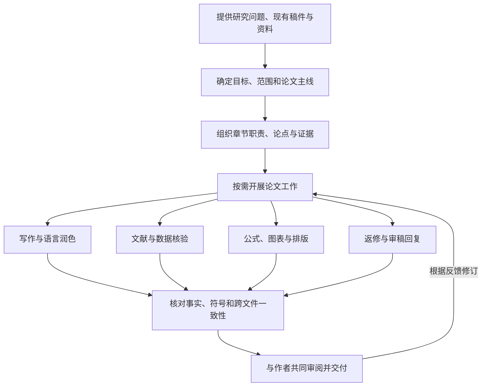
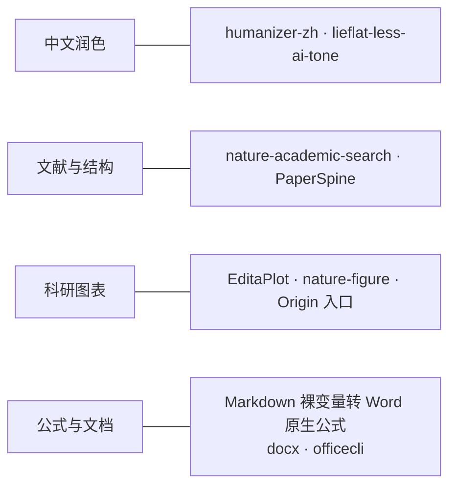
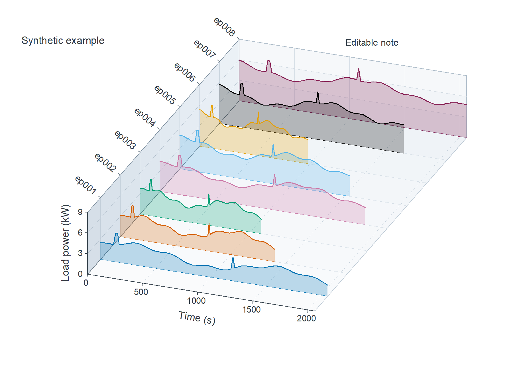

# Thesis Collaboration Framework

面向学位论文和期刊返修的通用论文协作技能。它以研究问题和可追溯证据为主线，连接论文框架、写作、文献、图表、Word 排版、补充材料与审稿回复，既支持完整论文项目，也支持单独的写作或修订任务。

框架先梳理研究问题、章节分工和论点依据，再结合稿件、数据与作者意见推进写作及返修。以 humanizer-zh 和 lieflat-less-ai-tone 的中文表达经验为基础，进一步整理了摘要、结论、结果分析、公式释义等具体写法，帮助作者把研究问题、数据和判断组织成连贯的论证。图表、公式、文献和正文共同服务于论文论证，其他内嵌技能按任务辅助。最终写法以作者确认的稿件和研究证据为准。

## 工作流程

完整论文可沿主线组织工作，局部任务按需要选取相关环节。写作以作者现稿为基准，并结合 humanizer-zh、lieflat-less-ai-tone 等技能，按任务调用其他工具和参考资料。

### 内嵌技能如何参与

框架负责组织问题、证据和协作，内嵌技能按任务提供具体方法。中文润色主要参考 humanizer-zh 和 lieflat-less-ai-tone，PaperSpine 用于需要时的研究或结构参考。作者的要求和当前稿件优先，内嵌技能不必全部运行。详见 [内嵌技能清单](thesis-framework-workflow/references/embedded-skills.md)。

公式处理包含自建的 [Markdown 裸变量转 Word 原生公式](thesis-framework-workflow/embedded/md-bare-var-to-native-equation/SKILL.md)：识别正文、释义和表格中的裸变量，规范为 LaTeX，并通过 Pandoc 生成 Word 原生公式（OMML）。按需转换为 MathType，实际执行取决于用户要求及本机软件。转换后仍须核对公式内容、符号和对象。

## 当前版本包含什么

- **论文主线与协作**：把研究问题、章节职责、论点和证据对应起来，按需使用任务卡、共享记录与交接材料。单人或单对话也可使用，无须强制建立多代理流程。
- **具体写作方法**：说明摘要、结论、数据结果和公式释义如何组织，提供连贯的中英文虚构示例及公开论文的写法分析。示例只用于学习，不能当作真实研究结果。见 [写作与证据](thesis-framework-workflow/references/writing.md)、[写作示例](thesis-framework-workflow/references/writing-examples.md)。
- **语言与作者风格**：以作者认可的现稿为基准。中文按需结合内嵌 humanizer-zh 和 lieflat-less-ai-tone，PaperSpine 按实际任务选用。英文长句和语态依语境调整，被动语态不是中文写作要求。
- **公式与结果核对**：同一变量沿用同一完整符号，同一完整符号对应一个含义。区分瞬时量、均值和估计量，并核对上下标、单位及相关文件。结果描述保留比较条件、关键数值和指标取舍，不把代理指标直接写成寿命结论。
- **返修与文档保护**：以作者当前成稿为依据，按授权范围协调正文、补充材料和回复信，保护 Word 中的公式对象、引用域和人工修改。附可编辑表格模板及工具选择说明。
- **图表与跨环境使用**：先核对数据口径和图表要回答的问题，再选择图型。支持常见比较图、时序图、分布图、热图及多种专业图型的设计与制作，包内含透视瀑布图示例和自动化源码。按实际能力验证，不假定每台机器都已安装 Origin 或 Word。

## 功能示例

### 科研图表类型

根据研究问题、数据结构和目标格式选择图型。除透视瀑布图外，包内工作流和 EditaPlot 还覆盖：

- **趋势与关系**：折线图、带误差线的趋势图、散点图和气泡图。
- **比较与分布**：柱状图、箱线图、小提琴图、直方图、雨云图及原始数据点展示。
- **矩阵与关联**：热图、混淆矩阵、桑基图和网络关系图。
- **专业数据**：XPS、XRD、红外光谱、循环伏安及阻抗等图型，以及其他支持的数据图。

图型的输入要求和可用范围见 [图型与支持情况](thesis-framework-workflow/embedded/editaplot/references/chart-selection.md)。具体制作可按任务选用 Origin、Python 等工具，Origin 自动化需要兼容的本机软件及依赖。某图型在一个版本验证通过，不代表其他电脑或所有数据结构均已验证。

### 透视瀑布图

下图是众多图型中的一个示例，使用合成轨迹展示多条时序数据及各自持续时间。此示例在 Origin 中以二维投影构建透视效果。制作方法、数据清单和软件要求见 [透视瀑布图说明](thesis-framework-workflow/references/origin-perspective-waterfall.md)。

### 学术表格

两级表头将物理类别、指标符号和单位分层呈现。下图使用虚构数据，配套的 [Word 模板](thesis-framework-workflow/assets/templates/two-level-three-line-table.docx) 可按研究需求编辑。

## 如何使用

将 [thesis-framework-workflow](thesis-framework-workflow/) **整个目录**复制到所用 agent 的技能目录，或在对话中直接提供其中的 [SKILL.md](thesis-framework-workflow/SKILL.md) 路径，让 agent 根据任务读取相关参考文件。路径相对技能包解析，不依赖原作者的工程、用户名、盘符或历史对话。不同 agent 的发现方式和权限可能不同，按其实际能力使用。

例如，可以提出：“请使用论文框架技能，依据我提供的结果修改摘要，保留比较对象和数值，只给文字版。” 也可以要求核对公式符号，或组织某一章的论点与证据。实际稿件、数据和学校或期刊规范由使用者提供。

首次迁移及可选的包检查见 [兼容说明](thesis-framework-workflow/references/portability.md)。核心写作规则可离线阅读，原生绘图、文档编辑和特定脚本需要相应软件或依赖。模板、章数、图型及格式应按当前研究和作者要求调整。

## 来源与分发

感谢 [EditaPlot](https://github.com/hang-jin/editaplot)、[Humanizer-zh](https://github.com/op7418/Humanizer-zh)、[lieflat-less-ai-tone](thesis-framework-workflow/embedded/lieflat-less-ai-tone/README.md)、[PaperSpine](https://github.com/WUBING2023/PaperSpine) 及其他创作者。第三方来源和适用范围见 [SOURCES.md](SOURCES.md) 和 [分发说明](thesis-framework-workflow/references/portability.md#分享与第三方许可)。

本项目的通用流程、模板与新增示例按仓库许可证分享。内嵌材料适用各自许可证，不能将根目录 Apache-2.0 推广至全部第三方内容。历史受限快照未因本次更新获得新增授权。复制技能不等于安装 Origin、Word 或运行环境。
