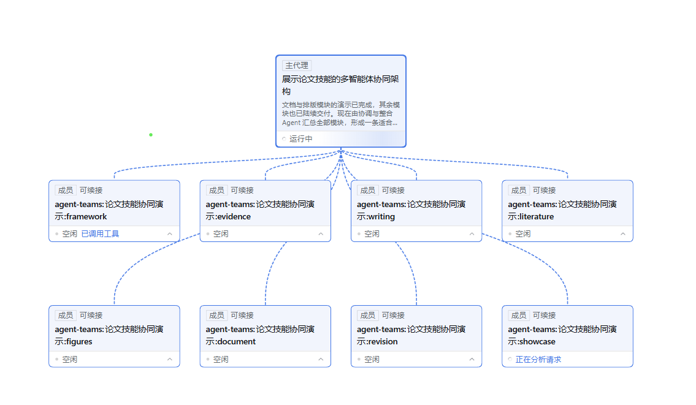
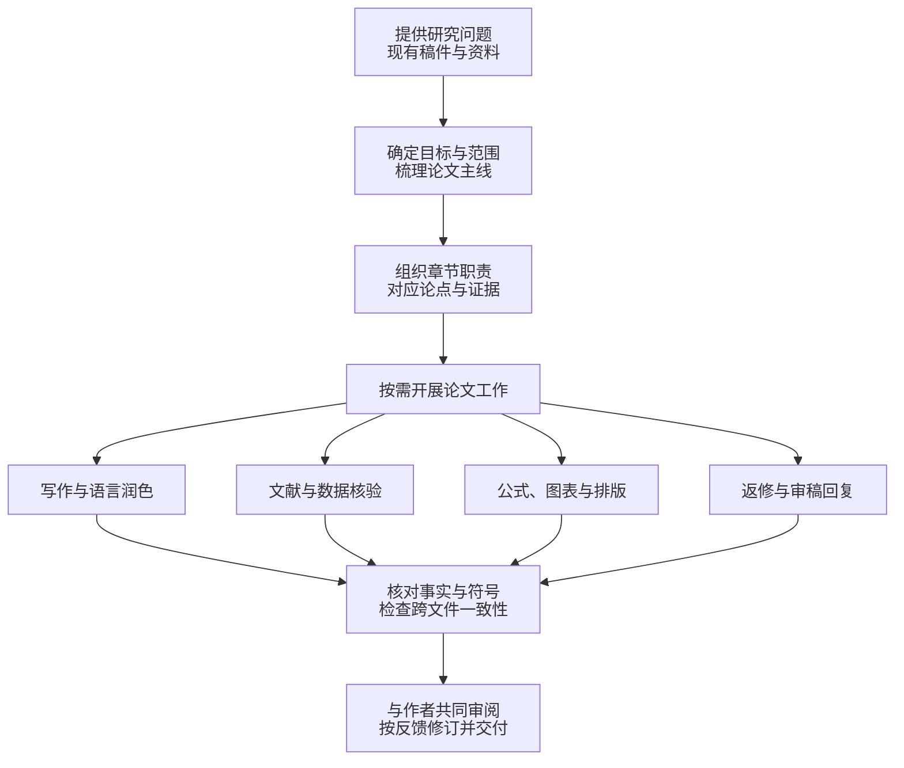
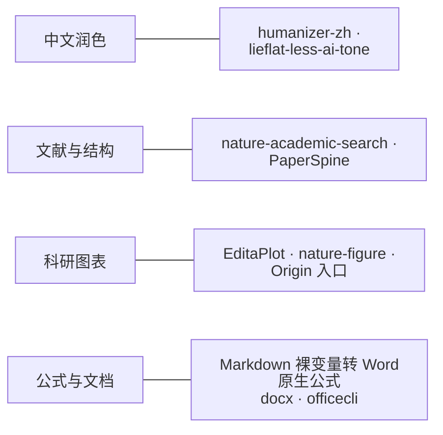
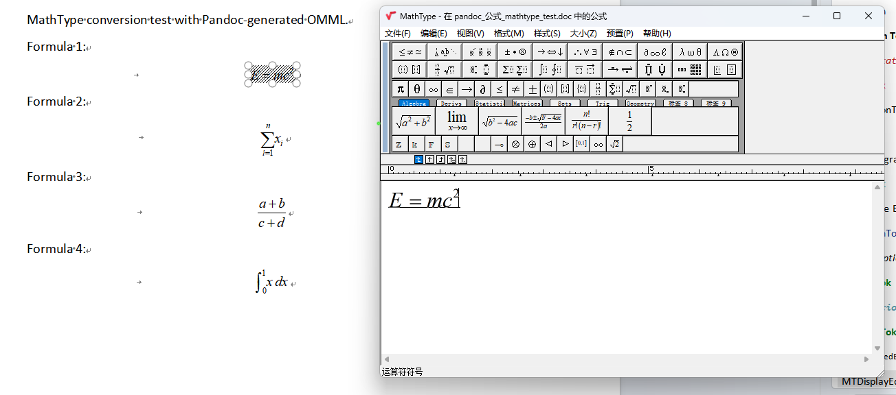

# Thesis Collaboration Framework

这是一套面向学位论文和期刊返修的协作技能。它围绕研究问题组织章节、文献、数据、图表和正文，也支持补充材料与审稿回复的编写。

框架先梳理研究问题、章节分工和论点依据，再结合稿件、数据与作者意见开展写作和返修。在 humanizer-zh 和 lieflat-less-ai-tone 的中文表达经验之上，我们进一步整理了摘要、结论、结果分析和公式释义的具体写法，帮助作者将研究问题、数据与判断组织成连贯的论证。

## 建议先整理论文工作区

建议先整理一个论文工作区，为多 agent 协同提供共同的资料入口和明确分工。各 agent 按模块或章节专注处理自己的任务，可独立的工作并行推进，减少重复读取材料、相互等待和文件冲突，充分发挥多 agent 的并行处理能力。

已有项目沿用现有目录，补齐本轮需要的入口即可。下面是可裁剪的示例：

```text
论文工作区/
├─ AGENTS.md       作者约定、技能入口和协作规则
├─ README.md       当前主稿、资料位置、任务进度与负责人
├─ 稿件/           当前主稿、章节底稿与版本记录
├─ 数据与证据/     来源索引、采用结果及处理代码
├─ 图表/           数据来源、绘图代码、可编辑工程与输出
├─ 文献/           引用库、原文位置与论点依据
├─ 任务/           分工、依赖及必要的交接记录
└─ 交付/           已确认的阶段成果
```

目录名称按团队习惯调整，已有实验归档通过索引接入。工作区入口写明哪个稿件和数据版本正在采用，让新接手的人或 agent 能定位材料。

分工可按章节或模块安排。例如：

| 任务 | 必读材料 | 负责产出 |
|---|---|---|
| 证据核对 | 指定数据、指标定义和待核问题 | 采用结果表及必要说明 |
| 某章节写作 | 章节规划、已确认结果和相关文献 | 本章底稿 |
| 本章图表 | 同一结果表、图表计划和样式要求 | 绘图代码、可编辑工程与图件 |
| 整合交付 | 已完成的图文、交接记录和作者修改 | 当前主稿与交付版 |

证据确认后，章节写作与图表制作可并行。每个任务写清目标、输入位置与版本、可写范围、依赖和交付物，只提供相关材料。当前主稿、共享数据表和图形工程各指定一名写入负责人，其他执行者提交独立候选。分工也可由同一 agent 分步完成，并行时遵循用户授权和平台能力。

下图为一次多 agent 协同演示。主代理协调任务并整合成果，各成员分别处理对应模块。



各任务完成一轮必要检查后交接成果及检查范围，整合者核对版本和跨模块一致性，发现问题后局部处理，复用已有核验。模板可选用 [工作区入口](thesis-framework-workflow/assets/templates/workspace-entry.md)、[任务卡](thesis-framework-workflow/assets/templates/chat-task-card.md) 和 [交接记录](thesis-framework-workflow/assets/templates/handoff.md)，小任务直接在消息中说明即可。

可以这样开始：

> 请使用论文框架技能，沿用现有目录整理工作区入口，确认当前主稿和资料来源，按证据核对、章节写作、图表制作和整合安排分工，写清每项任务的范围与交付物。

更多组织方法见 [工作区指南](thesis-framework-workflow/references/workspace-architecture.md) 和 [协作指南](thesis-framework-workflow/references/multi-chat-collaboration.md)。

## 工作流程

<div align="center">



</div>

完整论文可沿主线组织工作，局部任务选取相关环节即可。

### 内嵌技能如何参与



内嵌技能按任务选用，PaperSpine V6 的 Followwriting 可用于参考引导写作，也可用于研究设计和结构参考。作者的要求和当前稿件优先。详见 [内嵌技能清单](thesis-framework-workflow/references/embedded-skills.md)。

自建的 [Markdown 裸变量转 Word 原生公式](thesis-framework-workflow/embedded/md-bare-var-to-native-equation/SKILL.md) 技能将正文、释义和表格中的裸变量规范为 LaTeX，再通过 Pandoc 生成可编辑的 Word 原生公式（OMML）。需要 MathType 时，可在安装了 Word 和 MathType 的 Windows 环境中继续转换。

下图为已有转换测试截图：左侧是 Word 中的测试公式，右侧展示其中一个公式在 MathType 中打开后的编辑界面。



## 当前版本包含什么

- **论文框架**：明确研究问题与各章职责，建立论点和证据的对应关系，通过工作区入口、任务分工和交接记录衔接各项工作。
- **模块执行**：按任务含义选择模块，只读取必要材料。各模块集中做一轮必要检查，复用有效结果。完整段落或同批文字默认由一名只读子代理集中复查，微调、纯复查、用户禁止代理或平台不支持时由执行者自检。
- **论文写作**：按作者认可的稿件调整中英文表达，整理摘要、结论、结果分析和公式释义。中文摘要不超过 **300 字**，英文摘要不超过 **150 个词**，用户或目标规范另有明确要求时按其执行。参考 [写作与证据](thesis-framework-workflow/references/writing.md) 和 [中英文虚构示例](thesis-framework-workflow/references/writing-examples.md)。
- **公式与结果**：同一量沿用同一完整符号，同一完整符号只表示一个含义，字体、正斜体、粗细、上下标及单位遵循现稿约定。结果描述交代比较条件、关键数值和指标取舍，区分代理指标与实际寿命结论。
- **图表制作**：根据研究问题和数据选择图型，支持趋势图、比较图、分布图、热图及多种专业图型。包内提供合成数据示例和自动化源码。
- **返修与文档**：协调正文、补充材料和回复信，保护 Word 中的公式对象、引用域与人工修改。包内提供可编辑表格模板和工具使用说明。

## 功能示例

### 学术写作改写对照

以下为虚构示例，展示如何在保留事实和条件的同时调整表达。更多例子见 [学术写作改写对照](thesis-framework-workflow/references/writing-examples.md)。

**结果分析：把同一比较中的数字和解释放在一起**

> 修改前：缓变负荷下，方案 B 的平均能量消耗比方案 A 低 6.0%。同一条件下，源功率增量均方降低 30.0%，归一化跟踪误差从 1.5% 增至 1.8%。结果说明能耗和功率动态改善伴随跟踪精度代价。

> 修改后：缓变负荷下，方案 B 的平均能量消耗比方案 A 低 6.0%，源功率增量均方降低 30.0%，但归一化跟踪误差从 1.5% 增至 1.8%。能耗和功率动态改善伴随跟踪精度代价。

**研究叙述：保留统计方法，去掉文件操作**

> 修改前：我们先运行脚本生成训练曲线，再读取每个种子的 CSV，把结果写入工作簿，逐行检查后导出图像。每条轨迹的能耗先累计，然后在三个独立训练种子间计算均值和样本标准差。

> 修改后：能耗先在每条轨迹内累计，再在三个独立训练种子间计算均值和样本标准差。

**英文表达：拆分影响阅读的长句**

> 修改前：The same model is used for both datasets, while the policies are trained separately for each dataset and evaluated on their respective test sets.

> 修改后：The same model is used for both datasets. Policies are trained separately for each dataset and evaluated on their respective test sets.

### 科研图表类型

包内工作流和 EditaPlot 支持多种图型：

- **趋势与关系**：折线图、带误差线的趋势图、散点图和气泡图。
- **比较与分布**：柱状图、箱线图、小提琴图、直方图、雨云图及原始数据点展示。
- **矩阵与关联**：热图、混淆矩阵、桑基图和网络关系图。
- **专业数据**：XPS、XRD、红外光谱、循环伏安及阻抗等图型，以及其他支持的数据图。

图型的输入要求和支持范围见 [图型与支持情况](thesis-framework-workflow/embedded/editaplot/references/chart-selection.md)。可按任务选用 Origin、Python 等工具，Origin 自动化需要兼容的本机软件及依赖。

### 按截图复刻图型

给一张参考截图就能按原图复刻：面板怎么分、轴范围和刻度、图例位置、配色、线型与标记、标注和文字层级都照截图走，数据换成自己的。Origin 和 Python 两条路都支持，Origin 交付可编辑工程和原生图形对象，Python 交付绘图脚本和矢量图。

复刻只迁移版式和视觉编码，不改统计含义。截图里读不出的数值、误差定义和比较条件由作者补齐或核对，原图数据不直接搬进新图。

### 透视瀑布图

下图使用合成轨迹展示多条时序数据及各自持续时间，在 Origin 中以二维投影构建透视效果。制作方法、数据清单和软件要求见 [透视瀑布图说明](thesis-framework-workflow/references/origin-perspective-waterfall.md)。


### 学术表格

下图使用虚构数据，展示按物理类别、指标符号和单位组织的两级表头。[Word 模板](thesis-framework-workflow/assets/templates/two-level-three-line-table.docx)可按研究需求编辑。


## 如何使用

将 [thesis-framework-workflow](thesis-framework-workflow/) **整个目录**复制到所用 agent 的技能目录，或在对话中提供其中的 [SKILL.md](thesis-framework-workflow/SKILL.md) 路径，让 agent 按任务读取参考文件。技能包使用相对路径，不依赖原作者的工程或历史对话。

建议将技能入口和作者已确认的写作约定写入项目现有的标准 `AGENTS.md`，列为项目内高优先级规则，各任务使用同一份现行技能。可直接参考 [接入规则](thesis-framework-workflow/references/writing-review.md#接入现有项目)。客户端未自动加载规则时，在任务中提供相应文件路径。

例如，可以提出：“请使用论文框架技能，依据我提供的结果修改摘要，保留比较对象和数值，只给文字版。” 也可以要求核对公式符号，或组织某一章的论点与证据。稿件、数据和学校或期刊规范由使用者提供。

首次迁移及包检查见 [兼容说明](thesis-framework-workflow/references/portability.md)。写作规则可离线阅读，原生绘图、文档编辑和特定脚本需要相应软件或依赖。

## 来源与分发

感谢 [EditaPlot](https://github.com/hang-jin/editaplot)、[Humanizer-zh](https://github.com/op7418/Humanizer-zh)、[lieflat-less-ai-tone](thesis-framework-workflow/embedded/lieflat-less-ai-tone/README.md)、[PaperSpine](https://github.com/WUBING2023/PaperSpine) 及其他创作者。第三方来源和适用范围见 [SOURCES.md](SOURCES.md) 和 [分发说明](thesis-framework-workflow/references/portability.md#分享与第三方许可)。

本项目的通用流程、模板与新增示例按仓库许可证分享。内嵌材料适用各自许可证，历史受限快照的分发授权仍需分别核对。
