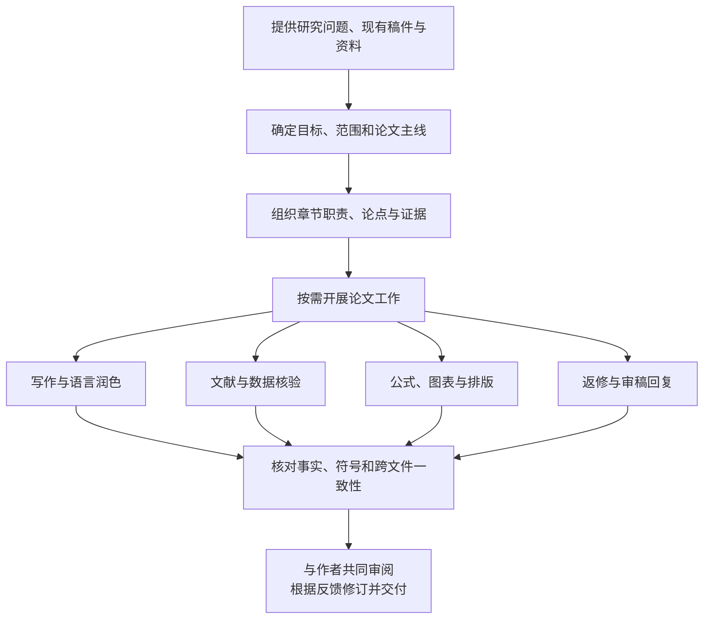
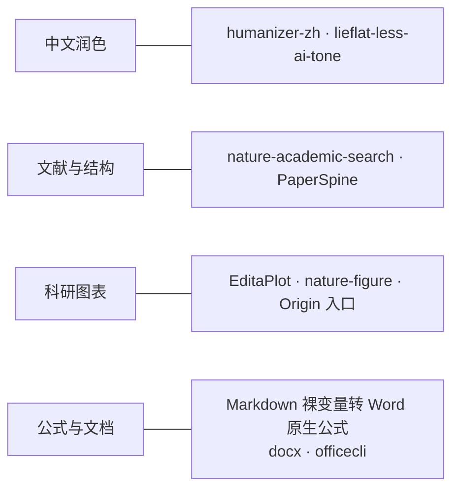
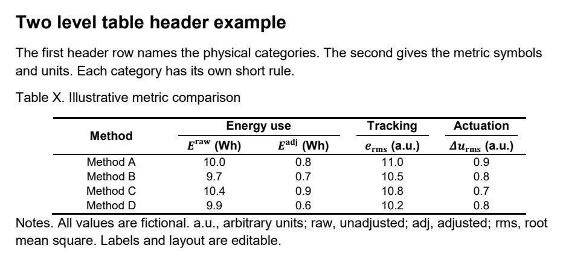

# Thesis Collaboration Framework

这是一套面向学位论文和期刊返修的协作技能。它围绕研究问题组织章节、文献、数据、图表和正文，也支持补充材料与审稿回复的编写。

框架先梳理研究问题、章节分工和论点依据，再结合稿件、数据与作者意见开展写作和返修。在 humanizer-zh 和 lieflat-less-ai-tone 的中文表达经验之上，我们进一步整理了摘要、结论、结果分析和公式释义的具体写法，帮助作者将研究问题、数据与判断组织成连贯的论证。

## 工作流程

完整论文可沿主线组织工作，局部任务选取相关环节即可。

### 内嵌技能如何参与

内嵌技能按任务选用，PaperSpine 可用于研究设计和结构参考。作者的要求和当前稿件优先。详见 [内嵌技能清单](thesis-framework-workflow/references/embedded-skills.md)。

自建的 [Markdown 裸变量转 Word 原生公式](thesis-framework-workflow/embedded/md-bare-var-to-native-equation/SKILL.md) 技能可以识别正文、释义和表格中的裸变量，将其规范为 LaTeX，再通过 Pandoc 生成 Word 原生公式（OMML）。如需 MathType，可在本机软件支持时转换，并核对转换后的公式内容和对象。

## 当前版本包含什么

- **论文框架**：明确研究问题与各章职责，建立论点和证据的对应关系，并按需记录任务与交接。
- **论文写作**：按作者认可的稿件调整中英文表达，整理摘要、结论、结果分析和公式释义。参考 [写作与证据](thesis-framework-workflow/references/writing.md) 和 [中英文虚构示例](thesis-framework-workflow/references/writing-examples.md)。
- **公式与结果**：同一量沿用同一完整符号，同一完整符号只表示一个含义，并核对上下标和单位。结果描述交代比较条件、关键数值和指标取舍，区分代理指标与实际寿命结论。
- **图表制作**：根据研究问题和数据选择图型，支持趋势图、比较图、分布图、热图及多种专业图型。包内提供合成数据示例和自动化源码。
- **返修与文档**：协调正文、补充材料和回复信，保护 Word 中的公式对象、引用域与人工修改。包内提供可编辑表格模板和工具使用说明。

## 功能示例

### 科研图表类型

包内工作流和 EditaPlot 支持多种图型：

- **趋势与关系**：折线图、带误差线的趋势图、散点图和气泡图。
- **比较与分布**：柱状图、箱线图、小提琴图、直方图、雨云图及原始数据点展示。
- **矩阵与关联**：热图、混淆矩阵、桑基图和网络关系图。
- **专业数据**：XPS、XRD、红外光谱、循环伏安及阻抗等图型，以及其他支持的数据图。

图型的输入要求和支持范围见 [图型与支持情况](thesis-framework-workflow/embedded/editaplot/references/chart-selection.md)。可按任务选用 Origin、Python 等工具，Origin 自动化需要兼容的本机软件及依赖。

### 透视瀑布图

下图使用合成轨迹展示多条时序数据及各自持续时间，在 Origin 中以二维投影构建透视效果。制作方法、数据清单和软件要求见 [透视瀑布图说明](thesis-framework-workflow/references/origin-perspective-waterfall.md)。

### 学术表格

下图使用虚构数据，展示按物理类别、指标符号和单位组织的两级表头。[Word 模板](thesis-framework-workflow/assets/templates/two-level-three-line-table.docx)可按研究需求编辑。

## 如何使用

将 [thesis-framework-workflow](thesis-framework-workflow/) **整个目录**复制到所用 agent 的技能目录，或在对话中提供其中的 [SKILL.md](thesis-framework-workflow/SKILL.md) 路径，让 agent 按任务读取参考文件。技能包使用相对路径，不依赖原作者的工程或历史对话。

例如，可以提出：“请使用论文框架技能，依据我提供的结果修改摘要，保留比较对象和数值，只给文字版。” 也可以要求核对公式符号，或组织某一章的论点与证据。稿件、数据和学校或期刊规范由使用者提供。

首次迁移及包检查见 [兼容说明](thesis-framework-workflow/references/portability.md)。写作规则可离线阅读，原生绘图、文档编辑和特定脚本需要相应软件或依赖。

## 来源与分发

感谢 [EditaPlot](https://github.com/hang-jin/editaplot)、[Humanizer-zh](https://github.com/op7418/Humanizer-zh)、[lieflat-less-ai-tone](thesis-framework-workflow/embedded/lieflat-less-ai-tone/README.md)、[PaperSpine](https://github.com/WUBING2023/PaperSpine) 及其他创作者。第三方来源和适用范围见 [SOURCES.md](SOURCES.md) 和 [分发说明](thesis-framework-workflow/references/portability.md#分享与第三方许可)。

本项目的通用流程、模板与新增示例按仓库许可证分享。内嵌材料适用各自许可证，历史受限快照的分发授权仍需分别核对。
